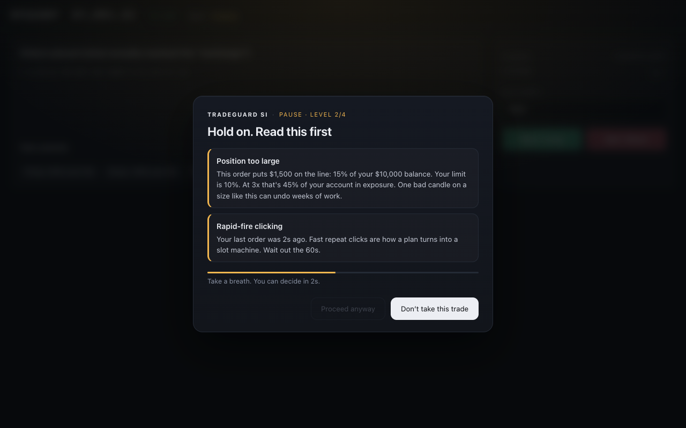
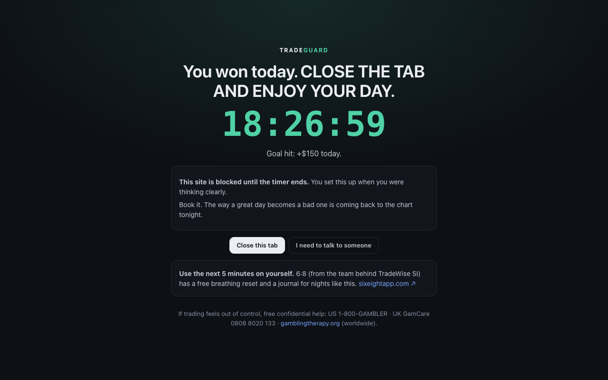
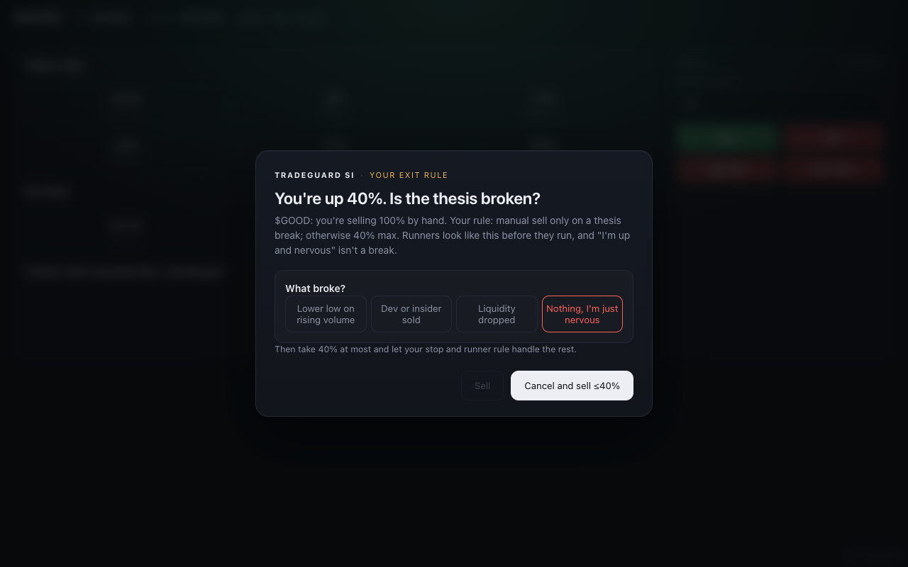
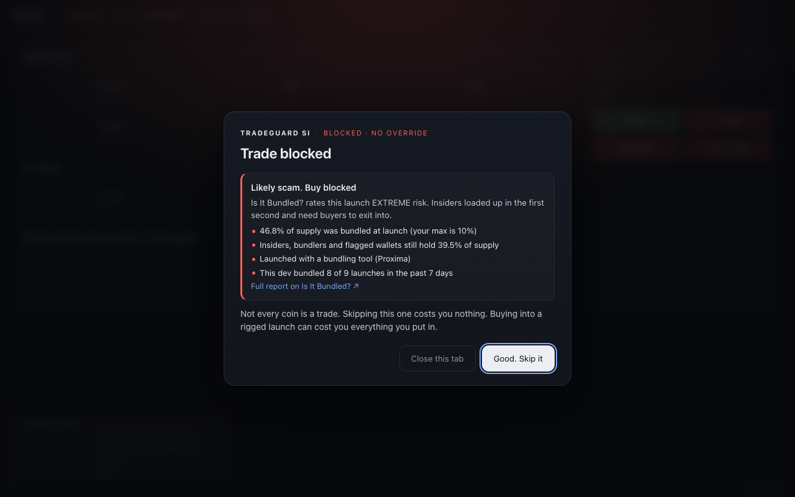
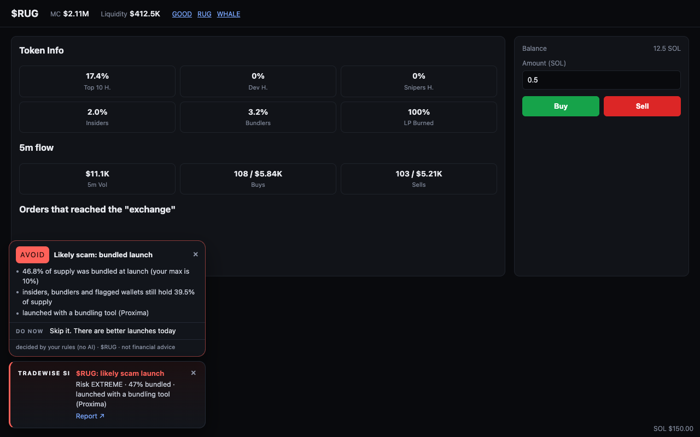
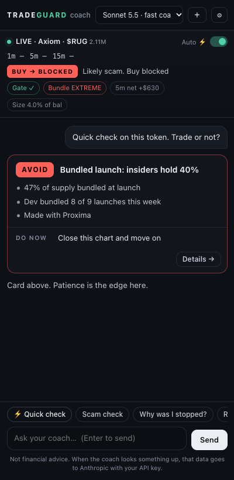

# TradeGuard SI

A Chrome extension that steps in **before** you place a bad crypto trade or buy into a rigged launch. It catches the order click on the exchange, checks it against your own rules, and adds friction that scales with how bad the trade looks. That runs from a warning, to a forced pause, to typing a confirmation phrase, to a hard lockout. It also tracks your mood and tightens the rules when you're tilted, anxious or chasing.

Tools like lockin.trade coach you *after* the fact, from read-only API data. TradeGuard SI works *at the moment of the click*, which is when the damage happens.



## Install (unpacked)

```bash
npm install
npm run build
```

1. Open `chrome://extensions`
2. Turn on **Developer mode** (top right)
3. Click **Load unpacked** and pick the `dist/` folder
4. The settings page opens. Set your account size and limits while you're calm.

Pin the shield icon. The badge shows trades today, or `LOCK` during a lockout.

## What it catches

| Rule | Triggers when | Friction |
|---|---|---|
| **Oversized** | Order is more than X% of balance (perps: margin, not notional) | Pause; hard stop above 2× the limit |
| **Overleverage** | Leverage above your cap | Pause; hard stop above 2× the cap |
| **Overtrading** | N trades this hour / M trades today | Pause (hourly) / hard stop (daily) |
| **Revenge** | New trade within N min of a logged loss | Pause; hard stop if sized ≥1.5× the losing trade |
| **Chasing** | Price already ran X% in the last Y min (buys), or dumped (perp shorts) | Pause; hard stop at 2× the threshold |
| **Daily loss** | Logged P&L today ≤ −$limit | **Lockout until midnight** |
| **Tilt** | N consecutive logged losses | **Lockout** for N minutes |
| **Mood** | Check-in ≤2/5 or tagged FOMO/angry/euphoric | Limits halved, friction +1 level |
| **Entry gate** (memecoins) | Buy fails your checklist, read off the token page: LP burned, dev holding, top-10 %, snipers + bundlers + insiders %, liquidity ≥ N× your size | Hard stop by default (configurable: pause / hard stop / block) |
| **Scam check** (memecoins) | [Is It Bundled?](https://isitbundled.com) shows a bundled launch: supply bundled above your max, flagged wallets still holding, Proxima/Sumo bundling tools, a dev who bundles repeatedly, wallets funded together | Pause → hard stop; **"extreme" risk is blocked with no override** |

Sells are never entry-gated or scam-blocked. Cutting a losing or flat position, or one without a recorded entry price, stays outside the manual-sell check. When you enable the manual-sell cap, selling more than that cap of a recorded winner asks you to name a thesis break first.

When three or more serious warnings fire at once, friction goes up one level. Only lockout-class rules can reach level 4.

### Friction levels
1. **Heads up**: corner banner; the order goes through.
2. **Pause**: full-screen card naming the rule and your real numbers ("15% of your $10,000 balance. Your limit is 10%."). *Proceed* stays disabled through a countdown. *Don't take this trade* is the default button.
3. **Hard stop**: double countdown, then you must type your confirmation phrase (pasting is blocked).
4. **Lockout**: no override. A live timer, until it runs out.

**Commitment mode** (in settings): during a lockout you can't end it early, turn TradeGuard SI off, or edit your rules.

The **panic button** in the popup lets you lock yourself out for 30 min, 1 h, 4 h, or the rest of the day.

### Gambling-harm protections
Modeled on the responsible-gambling toolkit and adapted to trading. Each one is configurable under **Settings → Protections**, and **Load TradeGuard SI rules** applies the memecoin plan in one click.

| Protection | Behavior |
|---|---|
| **Stop-win** | Hit your daily profit goal → locked until midnight: *"CLOSE THE TAB AND ENJOY YOUR DAY"*, with a button that closes the tab and book-profit shortcuts (Jupiter swap link, vault address) |
| Loss limits | Daily ($ or SOL realized), weekly, monthly, max losing trades/day; optional 24h lockouts |
| Heater | Win streak + sizing up or speeding up → hard stop |
| Doubling up | Each order ≥1.3× the last → hard stop |
| Bankroll cap | Balance above cap → buys blocked until *you* sweep the excess to your vault (TradeGuard SI never moves funds) |
| Entry discipline | Typed amount above quick-buy size · one A-setup/day · max buys/day · max open positions · no same-token rebuy after a loss · 15-min wait after a loss · cool-down after a big win |
| 3-line check | Before every memecoin buy: callout? late entry? limits? One "no" = skip (last gate before the buy) |
| Entry journal | Before that buy: tap whether higher lows are present and volume is building, then write your thesis and invalidation. These are saved with the trade. |
| Manual-sell cap | For a recorded winner, selling more than your cap requires a thesis-break reason: lower low on rising volume, developer/insider sale, or liquidity drop. Default off; the memecoin and “Let it run” presets use 40%. |
| FOMO-copy flag | Callout/chat lines like "it'll be too late later" are quoted back to you |
| Time | Reality checks every 30 min of chart time · forced break after a long session · daily screen-time cap · quiet hours |
| Rapid-fire | New order within 60 s → pause |
| Self-exclusion | Popup: 24h / 7d / 30d, can't be ended early |
| Cooling-off | Tightening a limit applies now; loosening waits 24h |
| Typed override (optional) | 60 s wait + written reason + long phrase, one trade at a time; reasons like "get back to even" are refused |

Lockouts take over every open trading tab the moment they start, whether from a click, a logged outcome or a Telegram `/lock`.



The **Let it run** preset sets a 25% stop distance and a 40% manual-sell cap. TradeGuard checks your click; it does not place stop orders. If the page doesn't expose the sell percentage, it asks you to confirm you're within the cap or name a thesis break, and cannot verify the percentage itself.



### Scam check
As soon as you open a token on Axiom, Photon, GMGN or BullX, TradeGuard SI looks up the launch on Is It Bundled? (cached for 5 minutes). If the launch is risky, a warning chip appears in the corner before you go near the Buy button. At the click, the result feeds the scam rule. Only the token's **public address** is sent. If the lookup fails or times out (3 s at the click), you get a warning and the order isn't held up.



### Live coach
The coach follows the page while you trade, **with the side panel open or closed**:

- **Installed (panel closed):** when you open a new token, TradeGuard SI runs a quick AI check and shows the verdict card on the page, next to the scam chip. It runs at most once per token every 10 minutes. You can toggle it with **Auto ⚡**.
- **Panel open:** a live strip updates every ~2 s. It shows the token and market cap, 1m/5m/15m moves, trend (lower highs / higher highs) from TradeGuard SI's own price sampling, gate ✓/✗, bundle risk, 5-minute net flow, your order as a % of balance, and **"BUY → BLOCKED / HARD STOP / PAUSE / CLEAR"**. That last one is exactly what would happen if you clicked Buy right now, computed locally for free. Every message you send includes this live snapshot plus your limits in force, so you never have to explain what you're looking at.
- **Chart image:** for quick checks and breakdowns, the coach attaches a screenshot of your chart when Chrome allows it. Chrome allows it after you open TradeGuard SI from its toolbar icon or ⌥⇧K on that tab. Otherwise the coach works from the numbers.



### Coach (Claude, side panel)
Open it from the popup or with **⌥⇧K**. It's built for speed: **⚡ Quick check** returns a verdict card you can read in three seconds:

| Verdict | Means |
|---|---|
| **AVOID** | Rigged launch or fails safety |
| **NO TRADE** | Safe enough, but no setup under your rules |
| **WAIT** | A setup could form. The card names the trigger to watch |
| **FITS YOUR RULES** | Passes your gate, trigger and risk rules (not a buy signal) |

Each card has up to three reasons with numbers, a "Watch" trigger, and one "Do now" action. Tap **Details** for the full breakdown (chart structure, levels, flow, trade math). The coach reads its data through tools: the current page (token stats plus the bundle report), your stats, trade log, check-ins, rules and lockout status, and the last intervention. It can **propose** rule changes as a card with an Apply button. It never changes anything itself, and it can't propose anything during a commitment-mode lockout.

- **Model:** Sonnet 5.5 (`claude-sonnet-5-5`, medium effort) by default. Switch to Opus 5.5 (`claude-opus-5-5`, high effort) for deep reviews.
- **Your own key, your choice of provider** (⚙ in the panel, any plan, never metered):
  - **Anthropic** (default): Claude, with adaptive thinking and prompt caching.
  - **OpenRouter**: one key for Claude, OpenAI, DeepSeek, Qwen and more. Cheaper picks are listed in the model menu (e.g. GPT-6 Luna, Qwen3.8 Flash, DeepSeek V4 Flash), and any OpenRouter model ID that supports tools works.
  - **OpenCode Zen**: Claude and Qwen models at Zen prices.
  - Keys are stored per provider in this browser only, never synced or exported, and sent only to that provider. Thinking and caching run only on Claude models; chart screenshots only go to models that accept images.
- **Hosted coach (Pro/Ultra):** no key needed; it runs the Claude models.
- The blocking itself never depends on the model. Rules run locally and instantly, even if the API is down.



### Mood and outcomes
- On your first order of a session (no check-in in the last 3 h), it asks how you are (1–5, plus tags like FOMO, angry, tired).
- Before the next order, it asks how your last trade went (win / loss / break-even, with optional P&L). Those answers feed the revenge, tilt and daily-loss rules. The pause is also a built-in moment to reflect.
- The **Dashboard** charts mood against outcomes and win rate by mood. It shows which rules fire most and how trades where you overrode a warning compare with clean ones ("When you check in as FOMO, you lose 80% of trades").
- Trades you backed out of are counted as **trades skipped**.

## Supported sites

Axiom, Photon, GMGN, BullX (memecoin terminals, SOL-denominated, with the entry gate and scam check), Polymarket and Kalshi (prediction markets), Jupiter and Robinhood (incl. on-chain stocks such as xStocks), Binance, Bybit, OKX, Coinbase Advanced, Kraken Pro, Hyperliquid, ARC Terminal, and any site you add under **Settings → Custom sites**. Custom sites use the generic adapter and ask for permission for that one site.

## Architecture

```
src/
  core/            pure, DOM-free, unit-tested
    engine.ts      evaluate(context) → verdict { level 0–4, hits, lockout }
    rules.ts       one function per rule, mentor-style messages with real numbers
    token-rules.ts entry gate + scam check (memecoin buys)
    mood.ts        check-in → limit multiplier + friction bump
    insights.ts    dashboard stats & plain-language patterns
  adapters/
    heuristics.ts  shared DOM reading: order buttons, size/total inputs, "10x", "Available", price in the tab title
    index.ts       per-site configs (≈10 lines each) + generic fallback
  content/
    content.ts     capture-phase interceptor, price sampler, replay-once
    overlay.ts     shadow-DOM intervention UI
  background/sw.ts badge, lockout expiry, custom sites, scam lookups, coach shortcut
  scam/            Is It Bundled? client (validated, cached, timeout)
  coach/           system prompt + tools for the Claude side panel
  ui/              popup, options, dashboard
  storage.ts       chrome.storage.local wrapper
```

**How the block works:** listeners on `window` in the **capture phase** (pointerdown → click) run before the exchange's own handlers. A click on an order control is swallowed with `stopImmediatePropagation()`. If you get through the friction, the click is replayed once on the same element through an allow-once flag, so it doesn't loop back into the interceptor.

**Chasing without an API:** while the tab is open, the content script samples the price every 3 s, from the tab title or a selector. It measures the run-up from the window's low.

### Adding a site
1. Add a config in `src/adapters/index.ts`: host regex, order-button wording, `spot | perp | 'url'`, and quote unit.
2. Add the origin to `content_scripts.matches` in `public/manifest.json`.
3. Load it, click an order button, and check the overlay quotes the right size and leverage. If not, add `panel`, `priceSelector` or `balanceSelector` hints.

## Privacy

This code is public so you can check every claim below. Data lives in `chrome.storage.local` on your machine. The extension makes **no** analytics or tracking calls. These are every outbound request it can make:

| Destination | When | What is sent |
|---|---|---|
| `isitbundled.com` | You open a token page (scam check on) | The token's public mint/pool address |
| `api.dexscreener.com` | Before a buy, if the late-entry rule is on | The token's public mint address |
| Solana RPC (default `api.mainnet-beta.solana.com`, configurable) | Every few minutes, only if you add a trading wallet | Your wallet's **public** address (reads swaps to log P&L) |
| `api.anthropic.com` | Only when you use the coach with **your own** Anthropic key (the default provider) | Your question, plus what the coach looks up: page snapshot, your rules and stats, trade log, optional chart screenshot |
| `openrouter.ai` | Only if you pick **OpenRouter** as the coach provider and save your OpenRouter key (Chrome asks for access then) | Same as the row above. OpenRouter forwards it to the model you choose (e.g. OpenAI, DeepSeek, Qwen, Claude) |
| `opencode.ai` | Only if you pick **OpenCode Zen** and save your OpenCode key (Chrome asks for access then) | Same as the Anthropic row. Chart screenshots only go to models that accept images |
| TradeGuard SI server | Only if you link an account (opt-in) | Coach requests on Pro/Ultra (same content as the row above, proxied); token address for the shared token check; and, only if you also tick *sync*, your trades, mood check-ins, lockouts and settings |

- It never asks for or reads private keys, seed phrases, exchange API keys or passwords, and never signs anything.
- It never places, changes or cancels an order. It only holds back or replays *your own* click.
- Export or delete your local data from Settings; linked accounts can export or delete server data from the account page.

## Known limitations (read these)

- **It's a speed bump, not a vault.** A determined trader can use another browser, their phone, or disable the extension. Commitment mode, locked rules and the site block make the impulsive path harder, not impossible.
- **Exchange DOMs change.** Adapters use text and label heuristics, not brittle class names, but a redesign can still break size or leverage reading. When the size can't be read, TradeGuard SI **fails open**: it shows a notice, skips size rules, and still enforces lockouts, overtrading, revenge and mood.
- **Only the mock pages are verified end to end.** Real venues need logins, so the first run on each venue is effectively a calibration.
- On-chain P&L covers Solana wallets. Other venues rely on outcomes you log.
- The scam check is only as good as Is It Bundled?'s coverage. Tokens it hasn't scanned get a soft "not scanned yet" nudge, not a block.
- Hotkey-based trading (some terminals buy on a keypress) isn't intercepted unless it goes through a form submit.

## Development

```bash
npm run dev        # rebuild on change (reload the extension in chrome://extensions)
npm test           # unit tests: rule engine, protections, distress, on-chain P&L, limits
npm run typecheck
npm run mock       # mock CEX, mock Axiom token pages, mock Is It Bundled? and mock Claude API on :5178
npm run e2e        # loads dist/ into Chromium and drives the real flows against the mocks
npm run zip        # Chrome Web Store build (no localhost access) → tradeguard.zip
```

## Roadmap

- Hotkey interception for Axiom's instant-trade keys.
- Exit-plan check (read the strategy rows on Axiom before a buy).
- A 30-trade review on the dashboard: expectancy by size tier and exit reason.
- Free preset sharing, starting with the "TradeGuard SI rules" preset.

## Hosted service

The extension is fully usable on its own with your own Anthropic key. The optional hosted service (account, coach without a key, sync, Telegram bot, shared token checks) is run by the TradeGuard SI team and is not part of this repository.

## Security

Please report vulnerabilities privately. See [SECURITY.md](SECURITY.md).

## License

[AGPL-3.0](LICENSE). Copyright © 2026 the TradeGuard SI authors. If you distribute a modified version, you must publish its source under the same license.

Not financial advice. TradeGuard SI never trades for you.
